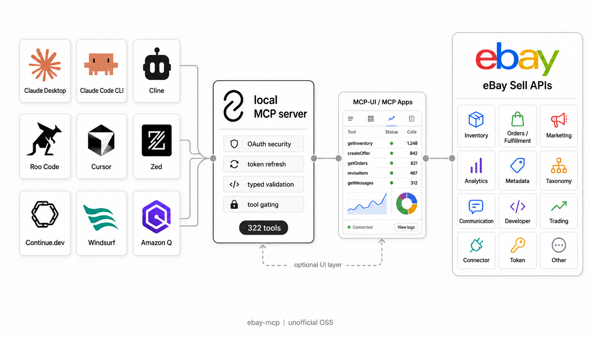
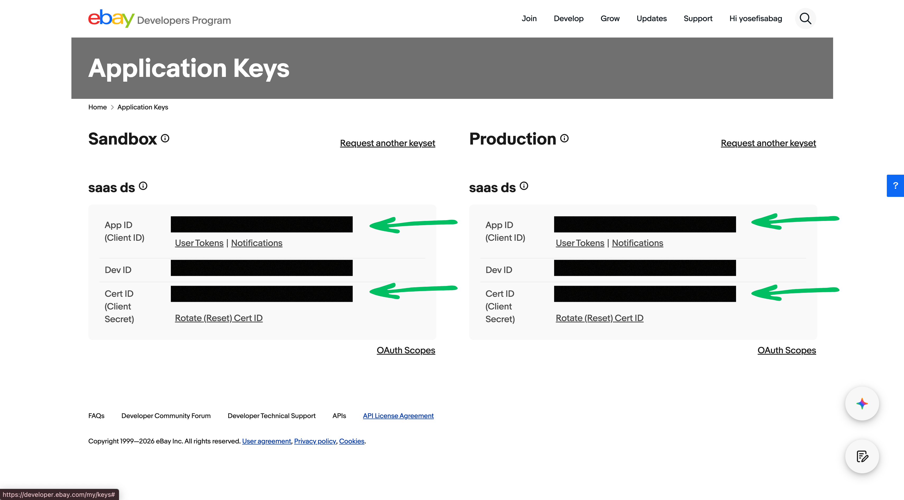
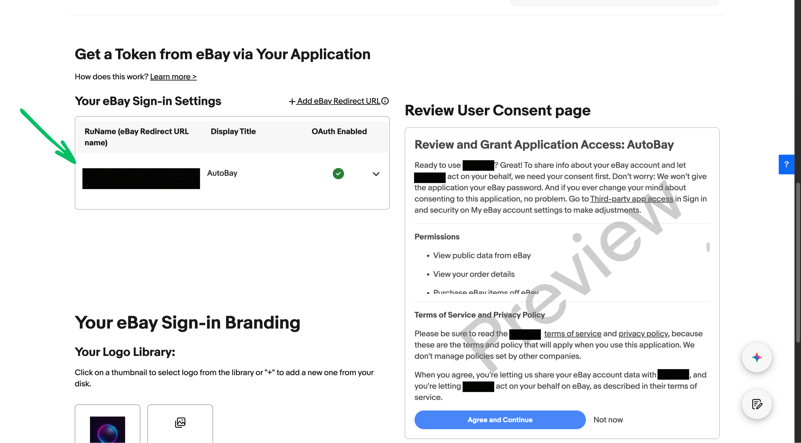
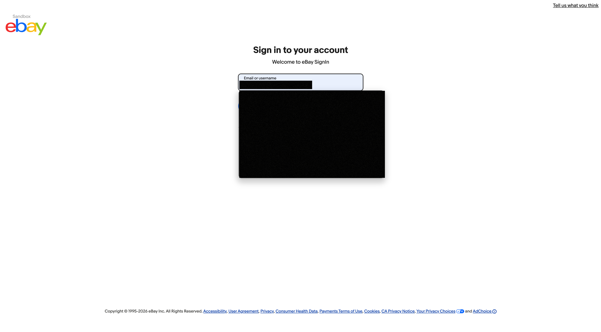
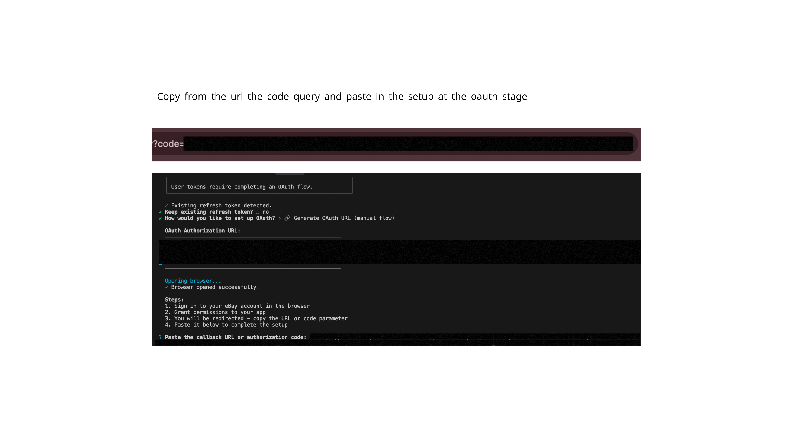

<p align="center">
  <a href="https://github.com/YosefHayim/ebay-mcp"></a>
</p>

<p align="center">
  <strong>A local MCP server that gives AI assistants 379 tools for the eBay Sell, Commerce and Developer APIs, running with your own keys.</strong>
</p>

<p align="center"><sub>Unofficial open-source project. Not affiliated with, authorized or endorsed by eBay Inc.</sub></p>

<p align="center">
  <a href="https://www.npmjs.com/package/ebay-mcp"></a>
  <a href="https://www.npmjs.com/package/ebay-mcp"></a>
  <a href="https://github.com/YosefHayim/ebay-mcp/actions/workflows/ci.yml"></a>
  <a href="LICENSE"></a>
  
</p>

<p align="center">
  <a href="https://yosefhayim.github.io/ebay-mcp/">Website</a> ·
  <a href="https://www.npmjs.com/package/ebay-mcp">npm</a> ·
  <a href="https://github.com/YosefHayim/ebay-mcp/releases">Releases</a>
</p>

## What it does

- Connects Claude Desktop, Claude Code, Cursor, Cline, Windsurf, Zed, Continue.dev, Roo Code and Amazon Q Developer to eBay. Any MCP client can connect.
- Covers inventory, orders, fulfillment, finances, feeds, stores, shipping labels, promoted listings, analytics, taxonomy, messaging and the legacy Trading API.
- Handles OAuth 2.0 with automatic token refresh, and retries `429` rate limits with backoff.
- Validates every tool input with Zod and uploads local photos and videos through the Media API.
- Runs on your machine over STDIO or HTTP. There is no cloud relay and your credentials stay local.
- Works with the eBay sandbox and production. One variable switches between them.

## Quick start

### 1. Get eBay keys

Create a free [eBay Developer Account](https://developer.ebay.com/). In the [Developer Portal](https://developer.ebay.com/my/keys), copy the **App ID (Client ID)** and **Cert ID (Client Secret)**.



In your app's **User Tokens** settings, copy the **RuName** (the eBay redirect URL).



### 2. Run the setup wizard

Needs [Node.js](https://nodejs.org/) 24 or newer.

```bash
npm install -g ebay-mcp
npx ebay-mcp setup        # or: npm run setup, from a source checkout
```

The wizard saves your credentials, opens the browser for eBay sign-in and configures your MCP client.



Paste the authorization code from the callback URL when it asks.



Watch the [video tutorial](.github/readme/video-tutorial.mp4) for the full flow.

### 3. Verify with a read-only request

Restart your MCP client and ask: "Check my eBay API rate limits." This calls `ebay_get_rate_limits` and proves the server, credentials and client wiring work without changing seller data.

### 4. Use it

Start with read-only questions. Move to tools that change data only after you confirm whether you are on sandbox or production.

To add the server by hand, use the Claude Code one-liner:

```bash
claude mcp add ebay --env EBAY_CLIENT_ID=your_client_id --env EBAY_CLIENT_SECRET=your_client_secret --env EBAY_ENVIRONMENT=sandbox -- npx -y ebay-mcp
```

Or add this to any MCP client config:

```json
{
  "mcpServers": {
    "ebay": {
      "command": "npx",
      "args": ["-y", "ebay-mcp"],
      "env": {
        "EBAY_CLIENT_ID": "your_client_id",
        "EBAY_CLIENT_SECRET": "your_client_secret",
        "EBAY_ENVIRONMENT": "sandbox",
        "EBAY_REDIRECT_URI": "your_runame",
        "EBAY_USER_REFRESH_TOKEN": "your_refresh_token"
      }
    }
  }
}
```

## Configuration

The setup wizard writes the variables for you. See [`.env.example`](.env.example) for the full list.

| Variable | Default | What it does |
| --- | --- | --- |
| `EBAY_CLIENT_ID`, `EBAY_CLIENT_SECRET` | none | Your eBay app keys. |
| `EBAY_ENVIRONMENT` | `sandbox` | `sandbox` or `production`. |
| `EBAY_REDIRECT_URI` | none | The RuName used for OAuth sign-in. |
| `EBAY_USER_REFRESH_TOKEN` | none | User token for higher rate limits. |
| `EBAY_OAUTH_SCOPES` | default scopes | Replaces the requested scope list. Keep the scopes you need. |
| `EBAY_MARKETPLACE_ID` | `EBAY_US` | Default marketplace, overridable per tool. |
| `EBAY_SITE_ID` | from marketplace | Trading API site override. |
| `EBAY_CONTENT_LANGUAGE` | `en-US` | Default request content language. |
| `EBAY_MCP_TOOLS` | `all` | Which tools are advertised. See below. |
| `EBAY_READ_ONLY` | `false` | When `true`, only read-only tools are registered. |
| `EBAY_MCP_UI` | `on` | `off` forces plain JSON instead of interactive views. |
| `EBAY_MCP_MEDIA_DIRS`, `EBAY_MCP_MEDIA_ROOT` | none | Directories the media and feed upload tools may read. Off until set. |
| `EBAY_SIGNING_KEY_JWE`, `EBAY_SIGNING_PRIVATE_KEY` | none | Digital Signatures for EU and UK sellers. Both come from `ebay_create_signing_key`. |
| `MCP_PORT`, `MCP_HOST`, `MCP_AUTH_TOKEN`, `MCP_CORS_ORIGINS` | none | HTTP mode settings. See [Run over HTTP](#run-over-http). |

### Tool exposure

A full catalogue takes a lot of context window. `EBAY_MCP_TOOLS` shrinks it:

| Value | Behavior |
| --- | --- |
| `all` (default) | Every tool is advertised at startup. |
| `dynamic` | Three discovery tools (`list_ebay_tools`, `enable_ebay_tools`, `disable_ebay_tools`). The agent loads only the tools it needs. Needs a host that supports `tools/listChanged`, such as Claude. |
| `inventory,fulfillment` | Only the named families, fixed for the session. Works on every host. |

The family list is literal. ChatGPT connectors need the `connector` family, for example `EBAY_MCP_TOOLS=connector,inventory`. An unknown family name fails at startup and prints the valid names.

### Read-only mode

Set `EBAY_READ_ONLY=true` to register only tools that read data (gets, lists, searches). Use it for first runs and for reporting assistants.

### Authentication and rate limits

| Mode | Daily limit | Setup |
| --- | --- | --- |
| Client credentials (default) | 1,000 requests | Automatic with Client ID and Secret. |
| User token (recommended) | 10,000 to 50,000 requests, by account tier | OAuth through the setup wizard. |

On a `429` the server retries with exponential backoff, then reports the error. Track usage in the [Developer Portal](https://developer.ebay.com/my/api_usage).

## Tools

Each family below is a valid `EBAY_MCP_TOOLS` value. The table is generated from the tool registry with `pnpm readme:tools`.

<!-- tool-families:start -->
| Family (`EBAY_MCP_TOOLS` key) | Title | Tools | Example tool |
| --- | --- | --- | --- |
| `connector` | Connector | 2 | `search` |
| `token-management` | Token Management | 10 | `ebay_get_oauth_url` |
| `account` | Account | 51 | `ebay_get_custom_policies` |
| `finances` | Finances | 11 | `ebay_get_order_earnings` |
| `inventory` | Inventory | 49 | `ebay_get_document` |
| `feed` | Feed | 23 | `ebay_get_order_tasks` |
| `stores` | Stores | 8 | `ebay_get_store` |
| `fulfillment` | Fulfillment | 17 | `ebay_get_cancellation_requests` |
| `logistics` | Logistics | 6 | `ebay_get_shipping_quote` |
| `marketing` | Marketing | 81 | `ebay_get_ads` |
| `analytics` | Analytics | 4 | `ebay_get_traffic_report` |
| `metadata` | Metadata | 27 | `ebay_get_exclude_shipping_locations` |
| `taxonomy` | Taxonomy | 8 | `ebay_fetch_item_aspects` |
| `communication` | Communication | 33 | `ebay_find_eligible_items` |
| `browse` | Browse | 2 | `ebay_find_active_items` |
| `other` | Other | 34 | `ebay_get_user` |
| `developer` | Developer | 7 | `ebay_get_api_status` |
| `trading` | Trading | 6 | `ebay_get_active_listings` |
<!-- tool-families:end -->

The full searchable tool list is on the [website](https://yosefhayim.github.io/ebay-mcp/).

Local media uploads support JPG, PNG, GIF, BMP, TIFF, WEBP, AVIF and HEIC up to 12 MB, and MP4 or MOV up to 150 MB. Files outside `EBAY_MCP_MEDIA_DIRS` or `EBAY_MCP_MEDIA_ROOT` are refused, and symlinks are checked before any upload.

## MCP Apps (interactive UI cards)

On hosts that support [MCP Apps](https://modelcontextprotocol.io), 15 core read tools show their results as sortable tables, detail cards, charts and stat grids instead of raw JSON. Other hosts get the same data as plain JSON. Set `EBAY_MCP_UI=off` to turn the views off. The views are read-only and are built by `pnpm build`.

## Run over HTTP

The Docker image starts the HTTP server (`node build/server-http.js`) on port 3000. Set `MCP_AUTH_TOKEN` to require a static Bearer token. Set `MCP_CORS_ORIGINS` to allow browser origins other than loopback. See the [Dockerfile](Dockerfile).

## Safety and scope

- Test in the sandbox first. Tools that create, revise, refund, end or buy (for example postage) change real eBay records in production.
- Use `EBAY_READ_ONLY=true` or a short `EBAY_MCP_TOOLS` list to limit what the assistant can do.
- Your credentials stay on your machine and go only to eBay.
- You must follow the [eBay API License Agreement](https://developer.ebay.com/join/api-license-agreement) and the [data-handling requirements](https://developer.ebay.com/api-docs/static/data-handling-update.html), and stay within rate limits.
- The software is provided "as is" without warranty. See [LICENSE](LICENSE).

## Troubleshooting

Run `npm run diagnose` first. Logs go to stderr so they never break the MCP stream.

- **Server not listed in the client:** restart the client and check the config path the wizard printed.
- **Auth errors:** check the keys, the environment and the RuName. Run the setup wizard again to refresh tokens.
- **`403 Missing x-ebay-signature-key`:** EU and UK sellers need Digital Signatures. Set both signing variables.
- **Empty results:** check `EBAY_MARKETPLACE_ID` and whether you are on sandbox or production.
- **No interactive views:** the host must support MCP Apps, and `EBAY_MCP_UI` must not be `off`.

### FAQ

**Does it work offline?** No. The server runs locally but calls eBay's live APIs.

**Sandbox and production?** Both. Switch with `EBAY_ENVIRONMENT`.

**Can I use it with ChatGPT?** Yes, with the `connector` family. See Tool exposure.

**Does it support auctions and the Trading API?** Yes. Offers take `format: "AUCTION"`, and the `trading` family covers legacy XML listings.

**How do I update?** Run `npm install -g ebay-mcp@latest`.

## Contributing

Fork, branch, add tests, run the checks, then open a PR with [Conventional Commits](https://www.conventionalcommits.org/).

```bash
pnpm lint && pnpm typecheck && pnpm typecheck:mcp-apps
pnpm test && pnpm build
pnpm readme:tools         # regenerate the tool family table
```

## License

MIT. See [LICENSE](LICENSE).

eBay is a trademark of eBay Inc. This project is not affiliated with or endorsed by eBay Inc.

<div align="center">
  <a href="https://www.buymeacoffee.com/yosefhayim"></a>
</div>
